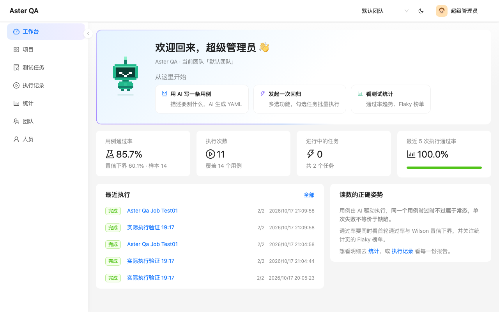
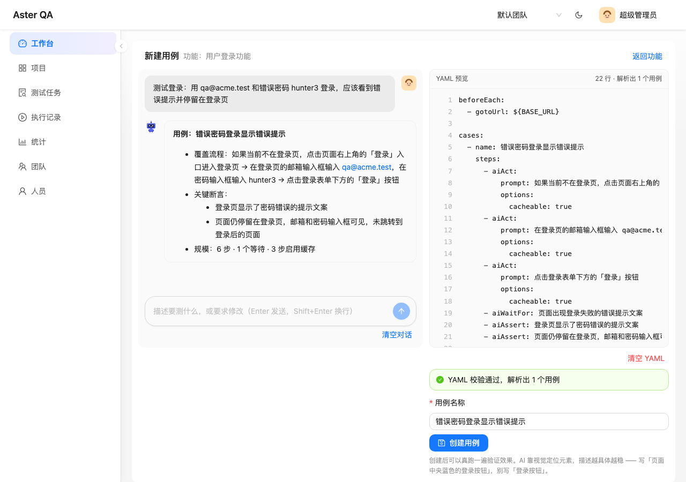
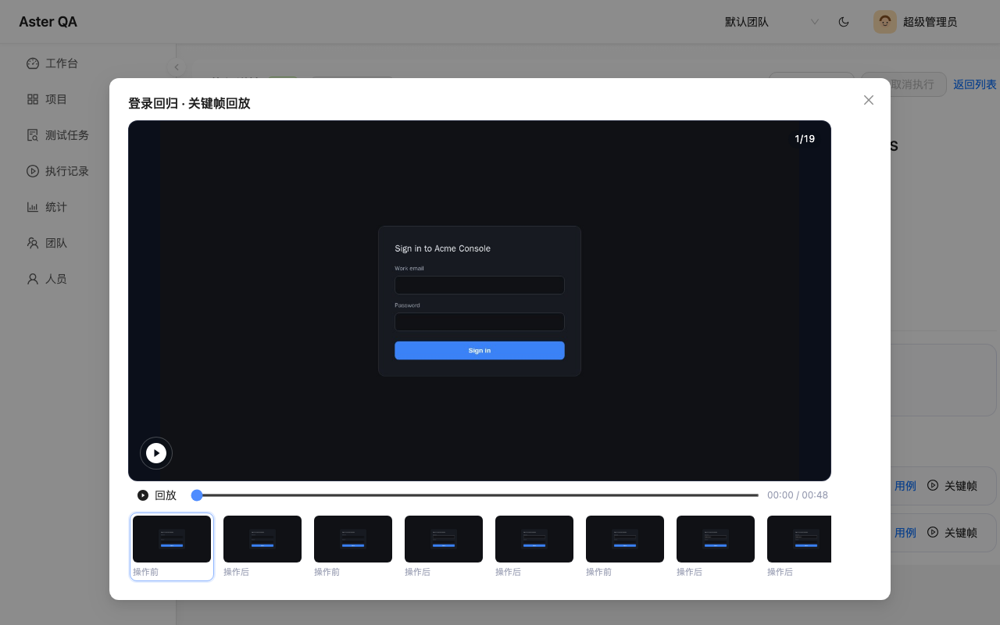
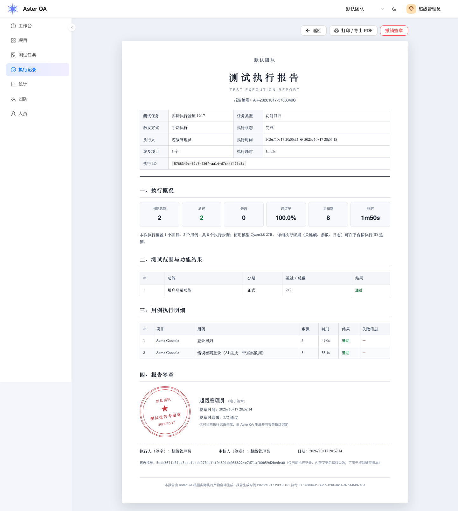
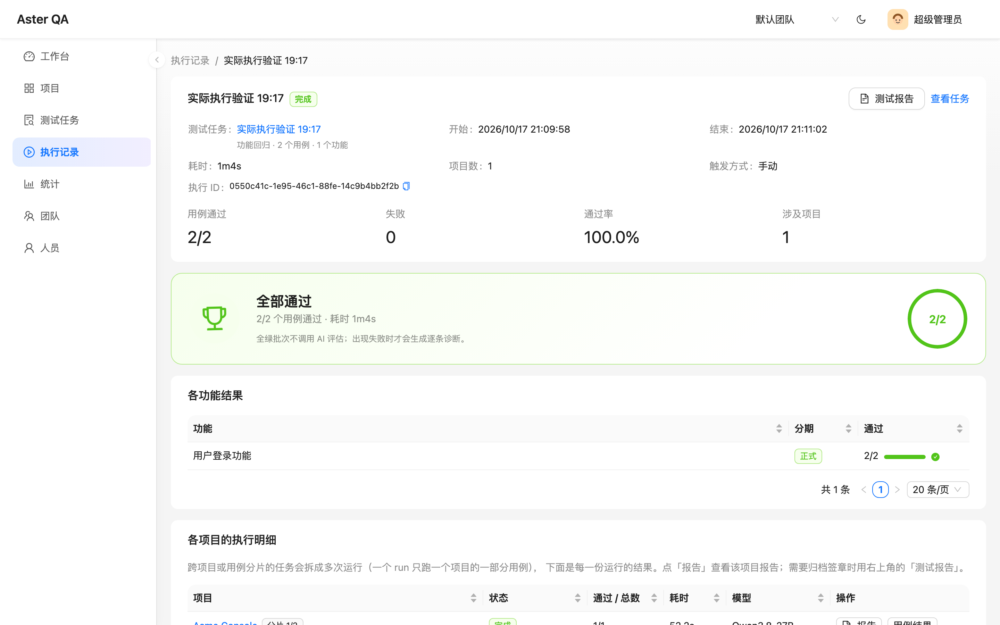
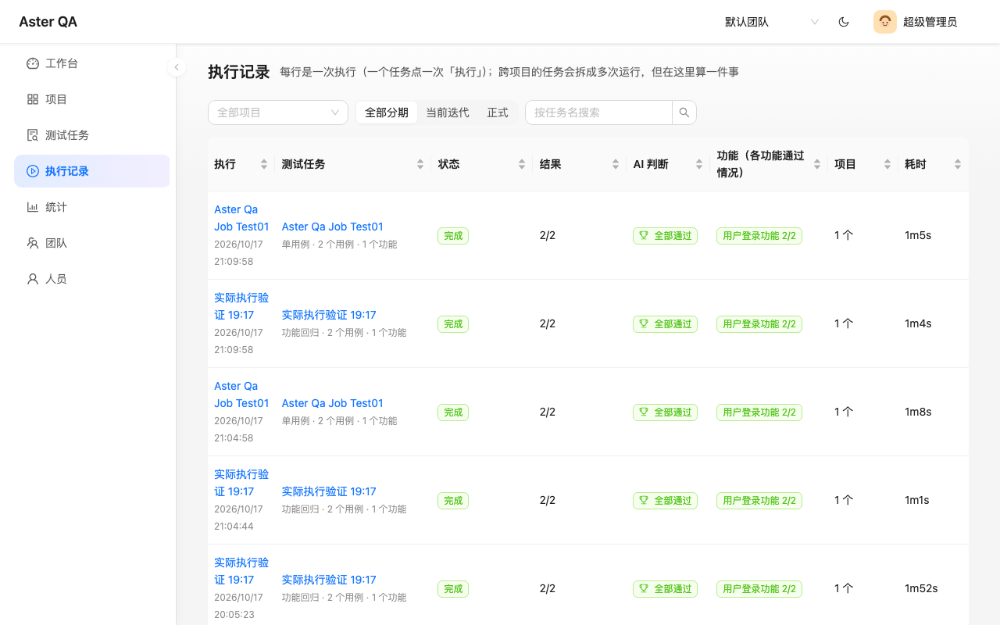
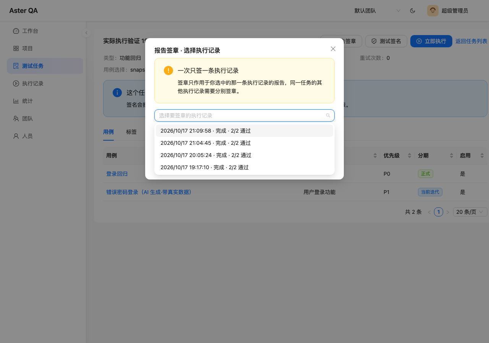
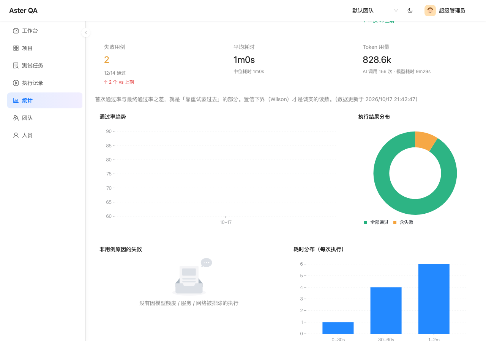

# Aster QA

**English** | [简体中文](README.md)

[](https://github.com/whalezhao/aster-qa/actions/workflows/ci.yml)
[](https://whalezhao.github.io/aster-qa/)
[](LICENSE)

**AI-driven test case and regression management.** One workflow from requirements and
features to test cases, execution, reports, and AI diagnosis.

> Project homepage: https://whalezhao.github.io/aster-qa/

Aster means “a radiating star” — one point that spreads into every test case. It is
also the idea behind the logo.

> Cases are authored and maintained by AI; humans review and sign off. Execution results
> are diagnosed step by step by AI reading the real artifacts. All-green batches skip
> the model and finish with a trophy card.

---

## Features

- **Projects / features / iterations / tags**: the hierarchy for test assets. Features
  carry requirement IDs from Zentao or Jira.
- **AI case authoring and iteration**: natural-language conversations produce executable
  YAML (streaming). The AI decides which steps should use the cache.
- **Tasks and batch execution**: a task is a snapshot of a set of features. Cross-project
  tasks are split into multiple runs. Large single-project tasks are sharded by “cases per
  run”. Multi-worker horizontal scaling and a global concurrency cap are supported.
- **Preflight checks**: model connectivity, environment, quota, target URL and worker
  availability in one place. Model failures block the run with a concrete reason.
- **Executions**: drill down from batch to run, case, and report. Reports are
  case-centric: each step has a keyframe timeline with replay plus parameters, output,
  logs, and reasoning.
- **Rerun failed cases only**: rebuild a batch from the failed cases of a batch or run,
  reusing the original environment and keeping parent/child lineage.
- **CI/CD and quality gates**: team API tokens trigger runs and read batch status; gates
  enforce a minimum pass rate and P0-failure policy for CI.
- **Scheduled regression**: one cron schedule per task with timezone support; overlapping
  runs are skipped and failures can notify.
- **Environments and variables**: multiple environments per project; plain variables use
  `${KEY}`, secrets are injected only into the process environment (`${{KEY}}`) and
  encrypted at rest.
- **Notification channels**: generic HMAC webhooks plus WeCom, Feishu, DingTalk and Slack
  bots.
- **Compliance-ready reports**: when one execution spans multiple projects, the run
  reports are merged into one formal report (report number, scope, summary, failures).
  Supports printing / PDF export and per-execution electronic signoff — one execution
  record per signature. The signature becomes invalid when the report content changes.
- **AI execution assessment**: reads the actual failed steps and failure reasons, then
  reports a root cause, ownership (case / product / environment), and concrete advice.
  All-green batches skip the model and use a trophy card.
- **AI case repair**: proposes revised YAML plus a diff from real failure evidence; the
  user confirms before it is saved as a new version.
- **Case version history**: snapshots on create, save, AI repair and rollback, with diff
  and rollback. Rollback creates a new version instead of deleting history.
- **Manual signoff**: creates a content-fingerprint signature for the task’s case set and
  marks it stale when the cases change.
- **Webhooks**: `task.signed`, `batch.completed`, `batch.assessed`,
  `quality_gate.failed`, `schedule.failed`, and `model.unhealthy`, with HMAC signing and
  exponential-backoff retries.
- **Statistics**: pass rate, Wilson lower bound, first-pass rate, flaky ranking, token
  usage, and a requirement coverage matrix.
- **Team review**: AI summarizes executions over a period and suggests improvements.
- **Project-level model configuration and token quota**: there is no global model. Each
  project selects its own model, and a monthly quota can block execution and AI calls.
- **Light/dark themes, an AI assistant, and speech output.**

## Screenshots

| Dashboard | AI case authoring |
|:---:|:---:|
|  |  |

| Case-centric report · keyframe replay | Compliance report · electronic signoff |
|:---:|:---:|
|  |  |

| Execution detail · sharding and AI verdict | Execution list |
|:---:|:---:|
|  |  |

| Report signoff · choose an execution | Statistics and AI review |
|:---:|:---:|
|  |  |

More screenshots and the project homepage: https://whalezhao.github.io/aster-qa/

## Tech stack

| Layer | Technology |
| --- | --- |
| Frontend | React 18 · Vite · Ant Design 5 · Ant Design X · TanStack Query |
| Backend | FastAPI · SQLAlchemy 2 (async) · Alembic · PostgreSQL 17 |
| Runner | Node 20 · Playwright · midscene-test (an isolated working directory per run) |
| Deployment | Docker Compose |

## Quick start (Docker Compose)

Prerequisites: Docker and Docker Compose v2.

```bash
git clone https://github.com/whalezhao/aster-qa.git
cd aster-qa

cp .env.example .env
# Edit .env: change at least POSTGRES_PASSWORD and SECRET_KEY
#   Generate SECRET_KEY with: openssl rand -base64 48

docker compose up -d --build
```

Services:

| Service | Address | Description |
| --- | --- | --- |
| web | http://localhost:8080 | Frontend (nginx, proxies /api and /reports) |
| api | http://localhost:8000 | FastAPI (API docs at /docs) |
| worker | — | Execution queue consumer with Node and Chromium |

Create the initial administrator and sign in:

```bash
docker compose exec api python seed.py admin admin123 "Default Team"
```

Then open http://localhost:8080.

> The worker image contains Chromium and is about 1.5 GB on the first build. If you only
> need the UI, start just `postgres api web`.

If the build cannot reach PyPI or npm (corporate proxy or restricted DNS), build with the
host network:

```bash
BUILD_NETWORK=host bash scripts/docker-build.sh
docker compose up -d
```

### First run

1. Sign in with `admin / admin123` (change the password from the top-right menu).
2. Open **Projects** → create a project and set the application Base URL.
3. Open the project → **Model configuration** → set the model name, family, base URL,
   and API key.
   **There is no global model. A project without a configured model cannot generate or
   execute tests.**
4. Create a feature → open it → **Write cases with AI**, and describe what to test.
5. Create a test task, select the feature, and run it. Open the execution to see results
   and AI diagnosis.

### Docker images (Docker Hub)

Each release publishes three images under `<version>`, `v<version>` and `latest`:

| Image | Purpose |
| --- | --- |
| `whalezhao/aster-qa-api:<version>` | FastAPI |
| `whalezhao/aster-qa-worker:<version>` | Runner (Node + Chromium) |
| `whalezhao/aster-qa-web:<version>` | Frontend (nginx) |

Run a pinned release:

```bash
cp .env.example .env
# set DOCKERHUB_NAMESPACE=whalezhao and ASTER_QA_VERSION=0.2.0
docker compose pull
docker compose up -d
```

Maintainer release:

```bash
docker login -u whalezhao
bash scripts/docker-release.sh
```

Pushing a `v*` tag also triggers `.github/workflows/docker-release.yml`, which builds
multi-arch images. The repository needs `DOCKERHUB_USERNAME` and `DOCKERHUB_TOKEN`
secrets.

## Local development

Prerequisites: Python 3.13 + [uv](https://docs.astral.sh/uv/), Node 20, and Docker (only
for PostgreSQL).

```bash
# 1. Database
docker compose up -d postgres

# 2. Configuration
cp backend/.env.example backend/.env
cp backend/runner/.env.example backend/runner/.env

# 3. Dependencies
cd backend && uv sync && cd ..
cd frontend && npm ci && cd ..
cd backend/runner && npm ci && npx playwright install chromium && cd ../..
```

Start all four processes (PostgreSQL + API + worker + frontend):

```bash
bash scripts/dev.sh
```

Open http://localhost:5173. Create an account on first use:

```bash
cd backend && uv run python seed.py admin admin123 "Default Team"
```

## Configuration

Every option is available as an environment variable. The backend reads `backend/.env`
(in Docker, Compose injects the values).

| Variable | Default | Description |
| --- | --- | --- |
| `DATABASE_URL` | `postgresql+asyncpg://qa:qa@localhost:5432/qa_manage` | Database connection string |
| `SECRET_KEY` | `dev-only-change-me` | JWT signing key. **Must be changed in production** (≥32 bytes) |
| `ACCESS_TOKEN_EXPIRE_MINUTES` | `720` | Login token lifetime |
| `CORS_ORIGINS` | `http://localhost:5173,http://127.0.0.1:5173` | Allowed frontend origins (comma-separated) |
| `RUNNER_DIR` | `runner` | midscene runner directory (relative to `backend/`) |
| `CASE_TIMEOUT_MS` | `600000` | Timeout for a single test case |
| `ARTIFACT_CLEANUP_ENABLED` | `true` | Whether to clean execution artifacts periodically |
| `ARTIFACT_RETENTION_DAYS` | `30` | Retention for artifacts without a task |
| `ARTIFACT_KEEP_PER_TASK` | `5` | Recent batches kept per task (shard runs in a batch are kept together) |
| `WORKER_CONCURRENCY` | `4` | Slot limit per worker process; the global cap is configured in the UI |
| `WORKER_REPLICAS` | `1` | Number of worker replicas (Compose scaling); still bounded by the global cap |
| `WORKER_STALE_SECONDS` | `90` | Worker heartbeat timeout before its runs can be recovered by another worker |

The runner also supports `HEADLESS`, `CHROMIUM_NO_SANDBOX` (needed inside containers),
and `MIDSCENE_*` variables. See `backend/runner/.env.example`.

### Execution concurrency and scaling

- **Global concurrency cap** is configured on the **Test tasks** page
  (`max_concurrent_runs`) and shared by all workers. Each worker process is also limited
  by `WORKER_CONCURRENCY`.
- **Horizontal scaling**: `docker compose up -d --scale worker=2`. Workers register
  through `worker_heartbeats`; a new worker only recovers runs owned by a worker whose
  heartbeat has expired, so it will not kill runs that are still executing elsewhere.
- **Speed up a single project with many YAML files**: “cases per run” splits the cases of
  one project into multiple runs, which are dispatched to different slots in parallel.
  Set it to 0 to keep one run per project (no sharding).
- Before scaling, check model concurrency/rate limits and machine memory. Each run is a
  Chromium instance; model calls are usually the real bottleneck.

## Data and artifacts

- Execution artifacts (reports, screenshots, logs) live in
  `backend/runner/.runs/<run_id>/` and are cleaned according to the retention policy.
- Metrics in the database are decoupled from artifacts: deleting files does not change
  statistics.
- Deleting a task also deletes its execution records and local artifacts (active runs are
  skipped).
- Migrations: `cd backend && uv run alembic upgrade head` (the API also runs them on
  startup).

## Tests

```bash
cd backend
uv run ruff check app worker.py scripts tests
uv run pytest -q
```

Frontend type check and build:

```bash
cd frontend
npm run build
```

## Directory layout

```
backend/
  app/                FastAPI app (api / models / ai_case / ai_review / quota / retention …)
  app/runner/         Runner wrapper (staging, subprocess, artifact parsing, path cleanup)
  migrations/         Alembic migrations
  runner/             midscene runner (Node, separate node_modules)
  worker.py           Execution queue consumer
  tests/              Pure-logic regression tests
frontend/
  src/pages/          Pages (projects / features / tasks / executions / stats / teams …)
  src/components/     Shared components (table adapter, AI mascot, logo, error boundary …)
  nginx.conf          Production reverse-proxy configuration
docker-compose.yml
```

## Design decisions

- **The runner is a separate process**: `uvicorn --reload` would kill long-running tasks,
  so the worker runs independently.
- **Task status is derived**: it is aggregated from runs rather than stored, and list
  reads self-heal historical drift.
- **Model configuration is project-level**: there is no global fallback, so there is no
  ambiguity about which model a case ran on.
- **AI advises, never blocks**: signing and execution remain possible; conclusions are
  stored and traceable.
- **Report access uses unguessable URLs**: reports need localStorage and independent
  subresources; signed URLs would be too costly.

## License

[MIT](LICENSE)

## Contributing

See [CONTRIBUTING.md](CONTRIBUTING.md) for development and pull-request guidance. For
security issues, follow [SECURITY.md](SECURITY.md) and report privately instead of
opening a public issue.
