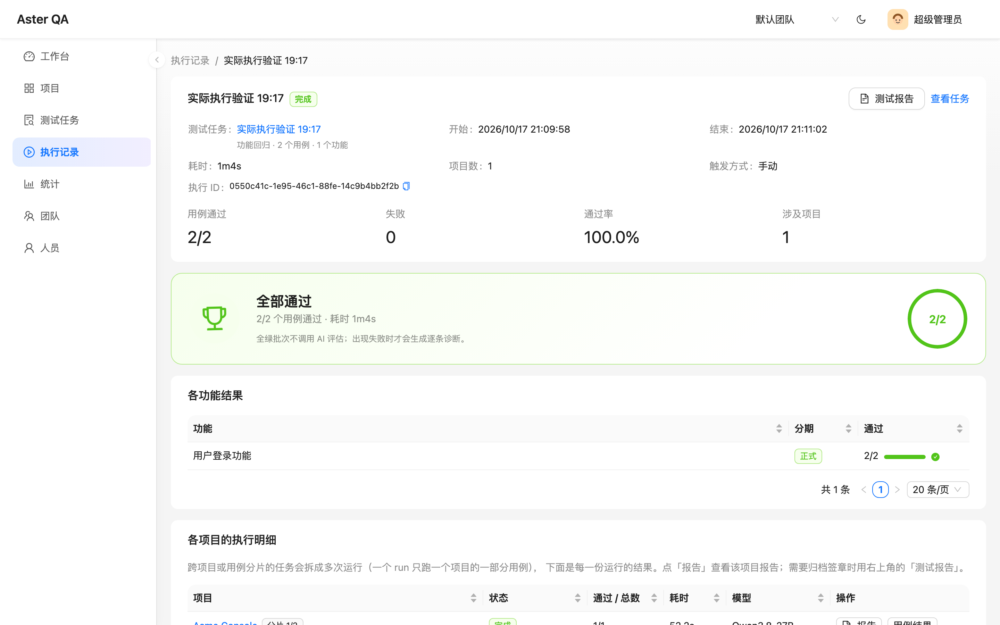

# Aster QA

[](https://github.com/whalezhao/aster-qa/actions/workflows/ci.yml)
[](LICENSE)

**AI 驱动的测试用例与回归管理平台。** 从需求/功能到用例、执行、报告、AI 诊断，一条链路走完。

Aster（星芒）取意「从一个点辐射出所有用例」—— 也是 logo 的由来。

> 用例由 AI 生成与维护，人只做审阅和签名；执行结果由 AI 读取真实产物做逐条诊断；
> 全绿批次不调模型，直接给结论。



---

## 功能

- **项目 / 功能 / 迭代 / 标签**：测试资产的组织层级，功能带需求编号（禅道 / Jira）。
- **AI 生成与迭代用例**：自然语言对话产出可执行 YAML（流式输出），AI 自行判断哪些步骤启用缓存。
- **任务与批量执行**：一个任务 = 一组功能的快照；跨项目自动拆成多次运行，单项目用例过多时按「单 run 用例数」分片，支持多 worker 水平扩容与全局并发上限。
- **执行记录**：批次 / run / 用例 / 报告四级下钻；报告以用例为第一层，步骤带关键帧时间线与回放、执行明细（参数 / 输出 / 日志 / 推理过程）。
- **合规执行报告**：一次执行跨多个项目时，自动把各 run 的报告合并成一份正式报告（报告编号、执行范围、结果汇总、失败详情），支持打印 / 导出 PDF 和按执行记录电子签章（一次只签一条执行记录）；报告内容变更后原签章自动失效。
- **AI 执行评估**：读取失败用例的真实执行步骤与失败理由，给出根因、责任归属（改用例 / 产品 / 环境）和逐条建议。全绿批次不调模型，用奖杯卡片收尾。
- **人工签名**：对任务用例集做内容指纹签名，用例变更后自动标记「已过期」。
- **Webhook**：`task.signed` / `batch.completed` / `batch.assessed`，HMAC 签名 + 指数退避重试。
- **统计**：通过率、Wilson 置信下界、首次通过率、Flaky 榜单、Token 用量。
- **团队复盘**：AI 汇总一段时间内的执行情况并给优化建议。
- **项目级模型配置与 token 限额**：不提供全局模型；每个项目自己指定模型，按月限额可拦截执行与 AI 调用。
- **深浅色主题、AI 助手、语音朗读。**

## 技术栈

| 层 | 技术 |
| --- | --- |
| 前端 | React 18 · Vite · Ant Design 5 · Ant Design X · TanStack Query |
| 后端 | FastAPI · SQLAlchemy 2 (async) · Alembic · PostgreSQL 17 |
| 执行器 | Node 20 · Playwright · midscene-test（每个 run 一个独立工作目录） |
| 部署 | Docker Compose |

## 快速开始（Docker Compose）

前置：Docker + Docker Compose v2。

```bash
git clone https://github.com/whalezhao/aster-qa.git
cd aster-qa

cp .env.example .env
# 编辑 .env：至少改 POSTGRES_PASSWORD 和 SECRET_KEY
#   SECRET_KEY 生成：openssl rand -base64 48

docker compose up -d --build
```

服务：

| 服务 | 地址 | 说明 |
| --- | --- | --- |
| web | http://localhost:8080 | 前端（nginx，反代 /api 与 /reports） |
| api | http://localhost:8000 | FastAPI（/docs 可看接口） |
| worker | — | 执行队列消费者，内含 Node + Chromium |

初始化管理员并登录：

```bash
docker compose exec api python seed.py admin admin123 默认团队
```

然后打开 http://localhost:8080。

> worker 镜像包含 Chromium，首次构建约 1.5GB；只调界面可以只起 `postgres api web`。

如果构建时容器访问不了 PyPI / npm（企业代理、DNS 受限），用脚本 + host 网络构建：

```bash
BUILD_NETWORK=host bash scripts/docker-build.sh
docker compose up -d
```

### 第一次使用

1. 用 `admin / admin123` 登录（登录后可在右上角改密码）。
2. 进入「项目」→ 新建项目，填被测地址（Base URL）。
3. 进入项目详情 →「大模型配置」→ 填写模型名、模型族、接入地址、API Key。
   **平台不提供全局模型，项目没配好模型就不能生成/执行。**
4. 新建功能 → 打开功能 →「用 AI 写用例」，描述要测什么。
5. 新建测试任务，勾选功能并执行；执行记录里看结果与 AI 诊断。

## 本地开发

前置：Python 3.13 + [uv](https://docs.astral.sh/uv/)、Node 20、Docker（只用来起 PostgreSQL）。

```bash
# 1. 数据库
docker compose up -d postgres

# 2. 配置
cp backend/.env.example backend/.env
cp backend/runner/.env.example backend/runner/.env

# 3. 依赖
cd backend && uv sync && cd ..
cd frontend && npm ci && cd ..
cd backend/runner && npm ci && npx playwright install chromium && cd ../..
```

一键起四个进程（PostgreSQL + API + worker + 前端）：

```bash
bash scripts/dev.sh
```

打开 http://localhost:5173。首次使用先建账号：

```bash
cd backend && uv run python seed.py admin admin123 默认团队
```

## 配置

所有配置都有环境变量形式，后端读取 `backend/.env`（Docker 里由 compose 注入）。

| 变量 | 默认值 | 说明 |
| --- | --- | --- |
| `DATABASE_URL` | `postgresql+asyncpg://qa:qa@localhost:5432/qa_manage` | 数据库连接串 |
| `SECRET_KEY` | `dev-only-change-me` | JWT 签名密钥，**生产必须改**（≥32 字节） |
| `ACCESS_TOKEN_EXPIRE_MINUTES` | `720` | 登录 token 有效期 |
| `CORS_ORIGINS` | `http://localhost:5173,http://127.0.0.1:5173` | 允许的前端来源（逗号分隔） |
| `RUNNER_DIR` | `runner` | midscene 执行器目录（相对 `backend/`） |
| `CASE_TIMEOUT_MS` | `600000` | 单个用例执行超时 |
| `ARTIFACT_CLEANUP_ENABLED` | `true` | 是否定期清理执行产物 |
| `ARTIFACT_RETENTION_DAYS` | `30` | 无任务归属的产物保留天数 |
| `ARTIFACT_KEEP_PER_TASK` | `5` | 每个任务保留最近几个批次的产物（分片 run 同批一起保留） |
| `WORKER_CONCURRENCY` | `4` | 每个 worker 进程的槽位上限；全局并发在界面「全局执行并发」里配置 |
| `WORKER_REPLICAS` | `1` | worker 副本数（compose 水平扩容）；总量还要受全局并发上限约束 |
| `WORKER_STALE_SECONDS` | `90` | worker 心跳超时；超过后它名下的 run 才会被其他 worker 恢复 |

执行器还支持 `HEADLESS`、`CHROMIUM_NO_SANDBOX`（容器内需要）、`MIDSCENE_*` 等变量，见
`backend/runner/.env.example`。

### 执行并发与扩容

- **全局并发上限**在「测试任务」页配置（`max_concurrent_runs`），所有 worker 共享；
  每个 worker 进程还受 `WORKER_CONCURRENCY` 槽位上限约束。
- **水平扩容**：`docker compose up -d --scale worker=2`。worker 通过 `worker_heartbeats`
  心跳注册；新 worker 只会恢复失联 worker 名下的 run，不会误杀正在执行的其他 worker。
- **单项目多 YAML 提速**：「单 run 用例数」配置把同一个项目里的用例切成多个 run，
  分发到不同槽位并行执行；0 表示一个项目一个 run（不分片）。
- 扩容前先看模型服务的并发/限流和机器内存：每个 run 是一个 Chromium，模型调用才是
  最常见的瓶颈。

## 数据与产物

- 执行产物（报告、截图、日志）在 `backend/runner/.runs/<run_id>/`，按保留策略自动清理。
- 数据库里的指标与产物解耦：删文件不影响统计。
- 删除任务会连带删除它的执行记录与本地产物（正在执行的会跳过）。
- 迁移：`cd backend && uv run alembic upgrade head`（API 启动时也会自动执行）。

## 测试

```bash
cd backend
uv run ruff check app worker.py scripts tests
uv run pytest -q
```

前端类型检查与构建：

```bash
cd frontend
npm run build
```

## 目录结构

```
backend/
  app/                FastAPI 应用（api / models / ai_case / ai_review / quota / retention …）
  app/runner/         执行器封装（暂存、子进程、产物解析、路径清理）
  migrations/         Alembic 迁移
  runner/             midscene 执行器（Node，独立 node_modules）
  worker.py           执行队列消费者
  tests/              纯逻辑回归测试
frontend/
  src/pages/          页面（项目 / 功能 / 任务 / 执行 / 统计 / 团队 …）
  src/components/     通用组件（表格适配、AI 形象、Logo、错误边界 …）
  nginx.conf          生产反代配置
docker-compose.yml
```

## 设计取舍

- **执行器独立进程**：`uvicorn --reload` 会杀掉正在跑的长任务，所以 worker 单独跑。
- **任务状态是派生值**：由 runs 聚合，不单独维护，列表读取时自愈历史漂移。
- **模型配置项目级**：没有全局兜底，避免「不知道用例跑在哪个模型上」。
- **AI 只建议不阻断**：签名、执行照常可以进行；结论落库可追溯。
- **报告访问靠不可猜 URL**：报告需要 localStorage 与独立子资源，签名 URL 代价过大。

## License

[MIT](LICENSE)

## 参与贡献

开发和提交流程见 [CONTRIBUTING.md](CONTRIBUTING.md)；安全问题请按
[SECURITY.md](SECURITY.md) 私下报告，不要开公开 issue。
